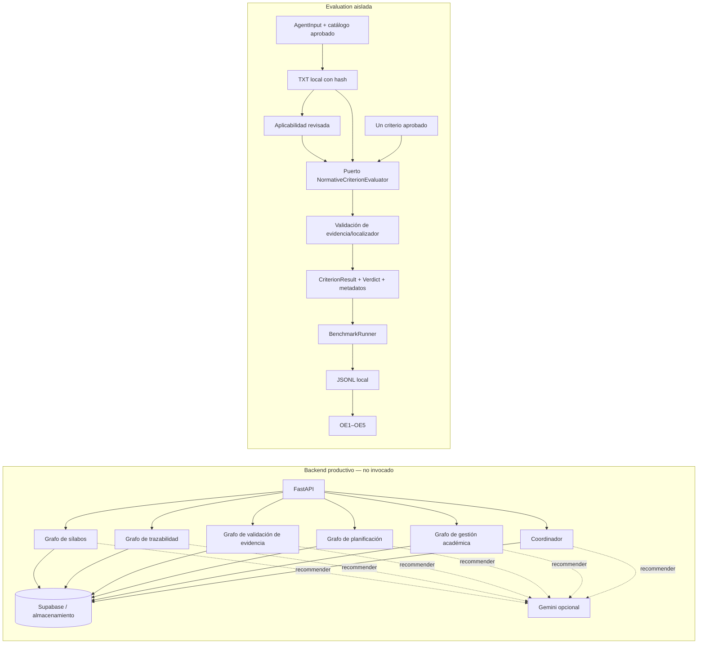

# Fase 5A — integración real: auditoría y seam experimental

## Resumen de estado

- **IMPLEMENTADO:** puerto inyectable de evaluación por criterio, plantilla de
  prompt versionada y hasheada, respuesta tipada, captura de modo/modelo,
  integración en el grafo y adaptador/runner locales; no requiere backend.
- **PROBADO:** cuatro pruebas nuevas con proveedor mock local: prompt sin Ground
  Truth, metadatos del modelo en registro/telemetría, evidencia de no conformidad
  localizada, abstención por evidencia no localizada, fallo sin fallback y
  rechazo de proveedor declarado externo.
- **PENDIENTE:** aislar capacidades de los grafos productivos, criterios oficiales
  aprobados, expedientes autorizados, proveedor real aprobado e inferencia real.
  Esta fase no conecta el nuevo seam a Gemini ni a tablas productivas.

## 1. Artefacto real identificado

El candidato a artefacto de investigación es el conjunto versionado del backend
que incluye seis grafos LangGraph, sus funciones deterministas, módulos de
recomendación y las dependencias de Supabase/documentos. **No es un único grafo
multiagente autónomo ni hay evidencia de que los seis grafos coordinen agentes
entre sí.** Cada uno es un flujo de nodos secuencial que comparte un diccionario
de estado dentro de su ejecución. Algunos intercambian datos indirectamente
mediante tablas de Supabase, y el coordinador consulta tablas, pero no invoca los
otros cinco grafos.

| Grafo productivo | Capacidad y nodos/responsabilidades | Reglas/análisis | IA generativa | Lectura/escritura/descarga |
|---|---|---|---|---|
| `syllabus_graph.py` | Obtener sílabo, validar archivo, extraer texto, analizar contenido, recomendar, guardar. | `curricular_analyzer.analizar_texto_silabo` detecta secciones, contenidos y resultados mediante reglas/keywords. | Recomendador Gemini de sílabos produce recomendaciones a partir de texto y análisis. | Lee `silabos`; descarga desde URL; elimina análisis previo e inserta en `analisis_silabo`. |
| `trazabilidad_graph.py` | Leer sílabos/análisis, agrupar por ciclo, analizar relaciones, detectar brechas, enriquecer, guardar. | Normalización de cursos, progresión, familias, intersecciones y brechas mediante funciones deterministas. | Recomendador Gemini enriquece relaciones/brechas. | Lee `silabos` y `analisis_silabo`; elimina filas de `trazabilidad_curricular` y filas pendientes de `brechas_curriculares`, luego inserta. El borrado de relaciones usa un filtro amplio con UUID centinela: alto riesgo para benchmark. |
| `validacion_evidencia_graph.py` | Obtener evidencia, extraer documento, validar reglas, recomendar y guardar validación. | `_evaluar_por_reglas` puntúa elementos detectados/faltantes; es pertinencia/validez documental del flujo actual, no conformidad frente a acreditación. | Recomendador Gemini de evidencia. | Lee `macroproceso_evidencias`; descarga URL; inserta en `validacion_ia_macroproceso_evidencias`. |
| `planificacion_graph.py` | Leer evidencias de planificación, calcular indicadores, detectar riesgos, recomendar y preparar resultado. | Avance, indicadores y riesgo con umbrales deterministas. | Recomendador Gemini de planificación. | Lee `macroproceso_evidencias`; el grafo prepara/devuelve resultado, no persiste una tabla de análisis en su nodo final. |
| `gestion_academica_graph.py` | Leer evidencias, indicadores, clasificación, acuerdos pendientes, riesgos, recomendar, preparar resultado. | Cálculo/clasificación y reglas de riesgo académicas. | Recomendador Gemini de gestión académica. | Lee `macroproceso_evidencias`; devuelve resultado, sin escritura del grafo observada. |
| `mejora_continua_coordinator.py` | Cargar panorama, analizar planificación/gestión/sílabos, integrar hallazgos, calcular riesgo, recomendar, devolver resultado. | Agregación y umbrales deterministas. | Recomendador Gemini coordinador. | `_safe_select` lee `macroproceso_evidencias`, `acciones_mejora`, `brechas_curriculares` y `silabos`; no se observó escritura del grafo. |

Los seis módulos importan directamente el cliente Supabase global; varios también
importan el lector con descarga remota y los recomendadores. Por eso importar
los grafos no constituye una frontera segura ni testeada de aislamiento. La
ruta de API [agentes.py](../backend/app/routes/agentes.py) llama las funciones
de ejecución y consulta resultados. La suite de evaluación no importa estos
módulos y esta fase no ejecutó ninguna ruta ni grafo productivo.

### Qué es multiagente aquí

Los nodos tienen nombres/responsabilidades diferenciadas, pero no se observan
mensajes independientes entre agentes, identidades/agendas de agentes,
delegación dinámica ni coordinación entre grafos en LangGraph. Los módulos
`gemini_*_recommender.py` son funciones de recomendación llamadas por un nodo,
no agentes autónomos separados. El coordinador vuelve a consultar Supabase y
recalcula hallazgos, no orquesta las salidas en memoria de los otros grafos.
Usar LangGraph en el evaluador experimental no lo convierte en el sistema
multiagente real.

## 2. Capacidades reutilizables y frontera productiva

**Reutilizable con precaución:** `curricular_analyzer.analizar_texto_silabo`
es una función determinista independiente que recibe texto/dict y retorna un
dict; puede evaluarse como componente curricular, pero no identifica por sí
misma criterios de acreditación ni sustenta una no conformidad oficial.
Funciones deterministas de normalización, riesgo y brechas también podrían
extraerse con tests de caracterización, manteniendo cada dominio separado.

**No extraído en esta fase:** mover helpers de `trazabilidad_graph.py`,
`validacion_evidencia_graph.py`, planificación, gestión o coordinador requiere
pruebas de caracterización de comportamiento y revisión de reglas de negocio.
Cambiar sus dependencias/estados puede alterar resultados productivos; se
documenta para la fase posterior, no se realiza automáticamente.

**No reutilizable como evaluador normativo:** recomendaciones generales de
Gemini, validador actual de evidencia, análisis curricular, riesgos de avance y
detector de brechas no incorporan catálogo aprobado/versionado ni aplicabilidad
normativa adjudicada. Reutilizarlos como juez de acreditación cambiaría su
semántica y podría convertir ausencias documentales en incumplimientos.

No ejecutar los grafos productivos en benchmark: hay SELECT, descargas, DELETE,
INSERT, Gemini y otras escrituras en rutas de negocio. Ninguna tabla de negocio
se ha modificado por esta fase.

## 3. Arquitectura experimental preparada

La ruta implementada consume `AgentInput` validado, catálogo aprobado, regla del
criterio, aplicabilidad revisada y documento local con hash; LangGraph construye
unidades de evaluación y recibe un evaluador por inyección. Por defecto sigue
usando `TransportOnlyEvaluator`, que nunca decide conformidad. La nueva
`PromptedNormativeEvaluator` solo acepta proveedores declarados locales/sin
llamadas externas y retorna resultados estructurados. El runner mantiene su
allowlist; `LocalNormativeGraphAdapter` valida que el evaluador no declare
escrituras/llamadas externas. El evaluador exige hash SHA-256 del catálogo
aprobado coincidente con `ExperimentConfig`; el grafo no invoca el provider si
la regla del criterio no está en la allowlist de reglas autorizadas.



Diagrama productivo derivado de los seis constructores y sus llamadas actuales;
las conexiones punteadas indican recomendadores invocados por nodos, no agentes
autónomos. El flujo experimental sí está implementado, pero el proveedor
demostrado es exclusivamente un mock de test.

## 4. Contrato, abstención y prompts

`NormativeCriterionEvaluator` recibe expediente, criterio, documentos extraídos,
registro de aplicabilidad/evidencias y `ExperimentConfig`; devuelve
`CriterionEvaluation` con `CriterionResult` más metadatos. El resultado preserva
ID de expediente/criterio/catálogo/versión, estado, clase, justificación y
evidencias; metadatos registran modo, proveedor, modelo/versión, hash/versión del
prompt y advertencias. El grafo/runner añaden ejecución, réplica, inicio/fin,
duración, hashes y errores.

Comportamiento fail-closed:

- Catálogo pendiente o aplicabilidad sin revisar/indeterminada no se evalúan.
- Documento faltante o hash/lectura inválida termina con error técnico de
  documento; no se vuelve no conformidad.
- Salida no evaluable/indeterminada se conserva como abstención.
- Una propuesta de `no_conforme` sin referencia de evidencia candidata se
  convierte en `no_evaluable/indeterminado`; después el localizador se verifica
  contra texto. Si no queda localizado, también se abstiene.
- Excepción del proveedor produce `InferenceFailure`, categoría
  `proveedor_llm`, modo intentado y metadatos del proveedor; no ejecuta fallback.
- `no_aplicable`, `no_conforme` y `indeterminado` siguen siendo resultados
  distintos; no se codifican reglas de acreditación no aprobadas.

La plantilla `normative-criterion-v1` incluye el criterio/regla versionados,
documentos autorizados, instrucciones para citar localizadores y abstenerse, y
prohíbe inventar normativa, páginas o citas. No recibe campos de Ground Truth ni
dictámenes de referencia. `PROMPT_SHA256` es la huella de la plantilla; la
configuración debe declararla. El mock en pruebas verifica esa separación. Esto
no valida científicamente ni la plantilla ni el resultado del evaluador.

El proveedor futuro debe implementar `InferenceProvider.generate(prompt,
config)` y exponer proveedor, modelo/versión, modo efectivo y capacidades de
llamada/escritura. Hoy no existe cliente Gemini en `evaluation/`; inyectar uno
externo es rechazado. Las propiedades son declaraciones de interfaz, no un
sandbox del sistema operativo: antes de habilitar proveedor hay que añadir una
frontera de proceso/red y controles de datos aprobados.

## 5. Gemini productivo: inspección, no invocación

Los seis recomendadores importan `google.genai` opcionalmente, construyen
`genai.Client(api_key=os.getenv("GEMINI_API_KEY"))`, seleccionan
`GEMINI_MODEL` con valor por defecto `gemini-2.0-flash` y usan
`client.models.generate_content(model=..., contents=prompt)`. En los usos
inspeccionados no pasan explícitamente `temperature`, `seed` ni schema de
respuesta; varios parsean JSON desde texto libre. Cada módulo tiene prompts y
fallbacks locales diferentes. Si no hay clave/SDK, falla/parsing inválido o
excepción, se devuelve resultado de reglas. `modelo_usado` suele señalar el
fallback, pero los intentos/errores se imprimen en consola; no es un registro
experimental suficiente ni homogéneo. Algunas ramas imprimen texto de respuesta
o `str(e)`, lo que no debe copiarse a logs de benchmark con documentos reales.

No se leyeron valores de credenciales ni se llamó Gemini. No se modificaron esos
recomendadores porque cambiar su fallback/logging podría afectar producción.
La integración futura deberá preservar el modo real de cada llamada y no
etiquetar un fallback como respuesta del mismo modelo.

## 6. Cinco instrumentos y campos

| Instrumento | Campo que consume | Salida experimental actual |
|---|---|---|
| `eval_precision_f1.py` | `CriterionResult.classification`, estado, enlaces de criterio/caso/versión; `ExecutionRecord.status` para abstenciones. | `CriterionResult` conserva estos campos y el runner enlaza `execution_id`; una respuesta no evaluable se cuenta como abstención. |
| `eval_bertscore.py` | `CriterionResult.rationale` por criterio frente a `GroundTruthRecord.reference_verdict`; enlaces y versión. | El contrato tiene rationale por criterio, pero la equivalencia semántica debe confirmarse con `--response-kind criterion_verdict`; output global `Verdict.rationale` no sustituye al dictamen por criterio. |
| `eval_coverage.py` | Aplicabilidad final validada + estado de evaluación vinculado a criterio/versión. | Disponibles `EvaluationState`, `ApplicabilityRecord`, links; necesita Ground Truth validado real, que no existe aquí. |
| `eval_telemetry.py` | estado, inicio/fin/duración, config y telemetría disponible. | Runner registra `duration_ns`, config, mode, errores, ahora también modo/proveedor/modelo/version por evaluación inyectada. No están instrumentados tokens/CPU/memoria/tiempos de nodo. |
| `eval_stability.py` | ejecución/réplica, labels, rationale global, config/corpus/versión. | `run_replicas` crea IDs y réplicas; mismo config se reutiliza. No se ejecutaron cinco inferencias reales; toda condición de modelo/proveedor debe quedar en config fija para no mezclar experimentos. |

No se cambiaron las fórmulas de los instrumentos. Limitación mínima restante:
el contrato `CriterionResult.rationale` no tipa formalmente “dictamen generado”
frente a explicación libre; OE2 lo confirma explícitamente en CLI. El esquema
`Evidence` almacena localizador/página/sección y no una cita de texto completa,
lo cual evita copiar extractos sensibles, pero requerirá un protocolo de
verificación de cita/página si el lector documental futuro ofrece paginación.

## 7. Reproducibilidad, réplicas y seguridad

`ExperimentConfig` contiene hashes de código, prompt, catálogo, corpus;
proveedor/modelo/versión reportada; versiones de dependencias; temperatura,
semilla y motivos cuando no aplican. El runner registra ejecución/experimento,
réplica, timestamps UTC, duración monotónica, modo, estado y errores. El grafo
registra SHA-256 por documento y el adaptador exporta metadatos por criterio. La
telemetría OE4 expone modos/modelos usados. Hashes/revisiones declarados no son
firmas ni prueban procedencia por sí mismos.

Para OE5 futuro, congelar una versión de corpus+hash, catálogo/versión, código,
prompt/hash, proveedor/modelo/versión, dependencias y parámetros; ejecutar cinco
veces el mismo expediente/configuración sin alterar prompt ni selección según
salidas intermedias. Cambiar configuración genera otro grupo experimental.
Temperatura 0 no garantiza determinismo de proveedor. Réplicas actuales son
secuenciales en `BenchmarkRunner`; el protocolo debe decidir si la independencia
requiere aislamiento de proceso/seed/orden y registrar eso antes del benchmark.

Separación actual: productivo y Supabase no se importan desde `evaluation/`;
Ground Truth no está en `AgentInput` ni en prompt; catálogo/entrada/corpus/
salidas JSONL/métricas son almacenes conceptualmente separados. Las pruebas
emplean fixtures sintéticos y temporales. Sin embargo, Python flags/allowlists
son controles de aplicación, no límites de red o filesystem. No usar datos
institucionales reales sin permisos, política de retención y entorno aislado.

## 8. Pruebas

Ejecutar desde raíz:

```powershell
.\.venv-evaluation\Scripts\python.exe -m unittest discover -s evaluation/tests -v
```

Resultado tras Fase 5A: **83 pruebas aprobadas** (78 anteriores + 5 nuevas).
Las pruebas nuevas utilizan
`LocalMockProvider`; verifican contrato y transporte, no capacidad real de
Gemini ni exactitud normativa. La suite no invoca servicios externos ni grafos
productivos. Mantener esta distinción en cualquier informe académico.

## 9. Pendientes y decisión de siguiente fase

1. Delimitar con asesoría qué partes de los seis grafos componen el artefacto de
   investigación y si se medirá el sistema completo o capacidades elegidas.
2. Obtener versión oficial de norma/criterios, reglas de aplicabilidad y
   autorización institucional documentada.
3. Definir adjudicación independiente del Ground Truth y permisos de corpus.
4. Diseñar extracción pura de funciones productivas con pruebas de
   caracterización. No reusar los entrypoints LangGraph mientras tengan
   Supabase/Gemini/descargas acoplados.
5. Aprobar proveedor y frontera de red/datos; resolver cómo reportar fallback y
   error por separado antes de implementar cliente real.
6. Verificar soporte de documentos autorizados, OCR/paginación/localizadores y
   control de datos personales.
7. Ratificar protocolo OE5 y confirmar qué representa el “dictamen por
   criterio” para OE2.

**Conclusión:** el puerto, el prompt y la ruta mock al runner están preparados y
probados como integración técnica. El benchmark real sigue **no preparado para
ejecución definitiva**: falta normativa y Ground Truth aprobados, permisos,
aislamiento de datos/proveedor y decisión sobre el alcance del artefacto. No hay
resultados de tesis ni validez científica demostrada.
