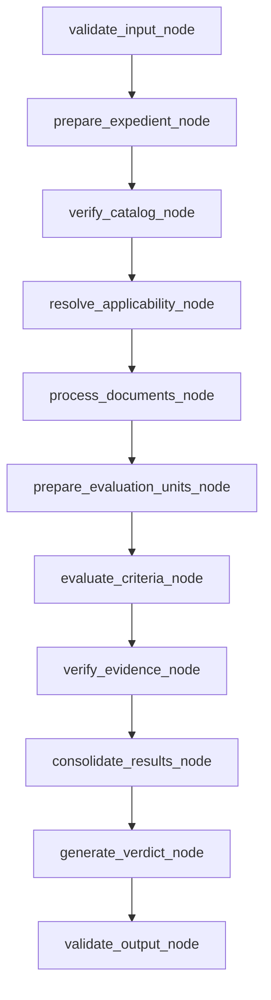

# Infraestructura experimental y normativa — Fases 1 y 2A

Para inventario y preparación de expedientes autorizados, plantillas,
congelación del corpus y validación estricta previa a métricas, consulte
[`DATASET_PREPARATION.md`](DATASET_PREPARATION.md). No hay dataset institucional
precargado: los fixtures siguen siendo exclusivamente sintéticos.

Este paquete es independiente de FastAPI y de los agentes productivos. Incluye
contratos y validadores para preparar una evaluación normativa y Ground Truth.
No hay criterios ISIA-UPAO/ICACIT auténticos precargados, evaluador normativo
real, integración con LangGraph, ni resultados de investigación.

## Arquitectura de Fase 2A

- `schemas.py`: expediente, documento, evidencia básica, criterio/resultado,
  dictamen, configuración, ejecución y estados separados.
- `catalog.py`: carga JSON, cálculo SHA-256 sobre bytes y validación de un
  catálogo/versionado. Todo archivo cargado queda pendiente; un campo `validated`
  en JSON se rechaza. `approve_catalog` registra una aprobación declarada con
  identidad, referencia y fecha, pero no autentica a la persona ni a la fuente.
- `contracts.py`: aplicabilidad por expediente/criterio/versión y evidencia con
  estado de localización. “Indeterminado” no se transforma en aplicable ni en no
  aplicable.
- `ground_truth.py`: anotaciones individuales, revisión, discrepancia, resolución
  y referencia final validada. Las decisiones no se generan desde LangGraph.
- `ground_truth_store.py`: JSONL local separado para snapshots de Ground Truth;
  los outputs están excluidos de Git.
- `agent_input.py`: allowlist tipada para los datos que podrían entregarse al
  agente. Solo admite catálogo marcado como validado y reglas autorizadas; la
  función de forma rechaza campos reservados de referencia.
- `dataset.py`: referencias cruzadas para IDs, versiones, evidencia, resultados,
  réplicas y estado de adjudicación. Los mensajes no incluyen contenido sensible.
- `runner.py` y `store.py`: runner sintético y registro experimental, no un
  adaptador real.

## Catálogo normativo

Ejemplo exclusivamente sintético (el archivo completo está en
`fixtures/synthetic_catalog.json`):

```json
{
  "disclaimer": "CATÁLOGO FICTICIO PARA PRUEBAS TÉCNICAS; NO ES OFICIAL NI CONTIENE CRITERIOS ICACIT.",
  "catalog_id": "SYNTH-CATALOG-001",
  "normative_version": "SYNTH-V1",
  "official_source": "synthetic://no-oficial",
  "validation_status": "pendiente_validacion",
  "criteria": [{
    "criterion_id": "SYNTH-CRIT-001",
    "official_id": "SYNTH-REF-001",
    "catalog_id": "SYNTH-CATALOG-001",
    "normative_version": "SYNTH-V1",
    "official_source": "synthetic://no-oficial",
    "text": "Criterio ficticio para verificar la carga del catálogo.",
    "applicability_rule": "No usar para decidir conformidad real.",
    "effective_from": null,
    "effective_to": null
  }]
}
```

El hash se calcula sobre el archivo JSON exacto. `expected_sha256`, si se entrega,
se compara con ese hash. El hash detecta cambios si el valor esperado se obtiene
por un canal confiable; **no es firma digital ni prueba que la fuente sea oficial**.
El catálogo permanece pendiente hasta que una persona aporte aprobación y
referencia documental mediante `approve_catalog`. El código no puede verificar
la autoridad institucional de esa aprobación.

## Aplicabilidad y evaluación

`ApplicabilityRecord` identifica expediente, criterio, catálogo y versión; tiene
estado `aplicable`, `no_aplicable` o `indeterminado`, justificación, estado de
revisión y referencias de evidencia. `CriterionResult` conserva por separado el
estado de evaluación (`evaluado`, `omitido`, `no_evaluable`, `no_aplicable`) y la
clasificación (`conforme`, `no_conforme`, `indeterminado`, `no_aplicable`). Sus
enlaces a expediente, catálogo/versión y ejecución son opcionales para preservar
lectura de registros sintéticos previos; la validación cruzada exige enlaces
completos cuando se presenta como resultado normativo.

No se implementaron reglas que decidan conformidad real. Sección documental
ausente, brecha curricular y observación académica no son sinónimos de no
conformidad frente a un criterio normativo verificado.

## Ground Truth, revisión y adjudicación

`GroundTruthAnnotation` representa una anotación de un evaluador, su versión,
fecha, etiqueta, aplicabilidad, evidencia y estado individual/revisado.
`GroundTruthRecord` reúne anotaciones para un expediente + catálogo + criterio +
versión. `has_disagreement` detecta diferencias de aplicabilidad/etiqueta.
`DisagreementResolution` exige anotaciones referenciadas, justificación,
adjudicador y fecha. Para estado final validado se exigen al menos dos
anotaciones revisadas, etiqueta y aplicabilidad finales, dictamen, responsable,
fecha y versión de validación; un desacuerdo debe tener resolución coherente.

Flujo humano previsto: anotación independiente → revisión de cada anotación →
comparación → resolución documentada si discrepan → aprobación final por
especialista. Los esquemas no autorizan a Codex ni al agente a producir las
etiquetas de referencia. En producción investigativa los especialistas deben
definir si el protocolo requiere dos o más revisores, perfil de adjudicador y
firmas/aprobaciones adicionales.

`GroundTruthStore` guarda snapshots en `outputs/ground_truth.jsonl`, separado de
`outputs/runs.jsonl`. No se proporciona a `AgentInput`. Estos controles son una
separación de módulos y allowlist en el código, **no control de acceso del sistema
operativo, cifrado, ni aislamiento absoluto**. Un proceso con acceso al archivo
podría leerlo; una persona podría falsificar metadatos de aprobación; un cambio
futuro podría romper la barrera. Aún no existen endpoints o roles de acceso.

## Validación de datasets

`validate_dataset` informa códigos/rutas para IDs duplicados, expediente o
criterio inexistente, versiones incompatibles, referencias de evidencia a
documentos ajenos, anotaciones/referencias no validadas, desacuerdos no
adjudicados, enlaces inconsistentes y réplicas repetidas. No incluye el texto de
documentos en los mensajes. La carga de catálogo detecta campos ausentes, JSON
inválido, IDs duplicados, versión o catálogo incongruentes y fechas invertidas.

Las referencias de evidencia se comprueban contra los IDs de documento del
expediente; el código no abre los documentos para verificar que una página,
fragmento o cita exista. Si falta fragmento, debe declararse el estado y la
limitación; no se inventa contenido.

## Separación del agente y datos de evaluación

Potencial entrada permitida: expediente autorizado, documentos/referencias,
catálogo aprobado y reglas autorizadas. Exclusivo de evaluación: etiquetas,
dictámenes de referencia, anotaciones, desacuerdos y adjudicación.
`agent_input.py` no importa `ground_truth.py`; su construcción usa tipos
permitidos y requiere catálogo validado. `validate_agent_payload_shape` rechaza
claves reservadas en estructuras JSON. No hay orquestador que conecte estos
módulos, y la inspección de claves no detecta toda forma posible de ocultar
información en texto libre. No se afirma aislamiento absoluto.

## Relación con objetivos de tesis

- **OE1:** instrumento Precision/Recall/F1 implementado; solo evalúa casos
  binarios aplicables con Ground Truth validado y reporta abstenciones aparte.
- **OE2:** pairing y ejecución local de BERTScore/coseno implementados; la
  inferencia requiere dependencias y modelos locales, que no están instalados.
- **OE3:** instrumento de cobertura sobre aplicabilidad final validada
  implementado; no equivale a conformidad/acreditación.
- **OE4:** reporte de latencia y telemetría observada implementado. La latencia
  depende del runner experimental; no representa servicios productivos si no
  se ejecuta allí bajo protocolo autorizado.
- **OE5:** estructura y comparación de las diez parejas entre cinco réplicas
  implementadas; coseno semántico pendiente de artefacto local de embeddings.

No ejecutar los grafos productivos como benchmark: realizan lecturas/escrituras
de Supabase y algunos descargan documentos o llaman al proveedor LLM. La futura
integración requiere un grafo nuevo o nodos puros con dependencias inyectadas,
entrada congelada/versionada y persistencia experimental separada. No hay
adaptador real en esta fase.

## Pruebas locales

Desde la raíz del repositorio, sin servicios externos:

```powershell
.\.venv-evaluation\Scripts\python.exe -m unittest discover -s evaluation/tests -v
```

Las pruebas emplean únicamente fixture sintético, mocks y archivos temporales.
No reportar sus salidas como métricas ni resultados de tesis. Las ejecuciones y
Ground Truth locales bajo `outputs/` están excluidos de Git mediante `.gitignore`.

## Pendientes

- Obtener norma, versión, criterios y reglas de aplicabilidad aprobados por la
  institución; el fixture de prueba no aporta ninguno.
- Obtener expedientes autorizados, política de datos y referencias documentales.
- Definir protocolo de anotación, etiquetas, revisores, adjudicación y aprobación.
- Revisar el alcance de “validado” con responsables institucionales.
- Compilar/ejecutar el adaptador LangGraph cuando la dependencia esté disponible
  en un entorno local autorizado; no se instaló durante esta fase.
- Antes de cualquier estudio, aprobar Ground Truth, protocolo experimental,
  tratamiento de abstenciones, artefactos/modelos y requisitos de telemetría.

Fase 2A aporta contratos y validadores locales; no carga normativa auténtica, no
evalúa expedientes institucionales, no produce Ground Truth oficial y no genera
resultados de investigación.

## Fase 2B — grafo normativo local

`normative_graph.py` define `NormativeGraphState`, nodos secuenciales y
`build_normative_graph()`, que compila con LangGraph si el paquete está instalado.
La dependencia **no está instalada en el intérprete local**, por lo que no se
afirma que el grafo haya sido compilado o ejecutado mediante LangGraph. Para
probar la misma secuencia de funciones locales existe `run_normative_pipeline`;
esta prueba de nodos no sustituye la prueba de compilación LangGraph.

El flujo definido es el siguiente:



- `validate_input_node`: acepta `AgentInput`, raíz local y configuración
  sintética. Rechaza campos adicionales; no devuelve eco de una entrada rechazada.
- `prepare_expedient_node` y `verify_catalog_node`: comprueban expediente y
  catálogo aprobado/versionado.
- `resolve_applicability_node`: usa registros revisados recibidos; si faltan o
  siguen pendientes, conserva aplicabilidad indeterminada.
- `process_documents_node`: solo llama al lector local descrito abajo.
- `prepare_evaluation_units_node` y `evaluate_criteria_node`: producen un
  resultado por criterio. `TransportOnlyEvaluator` devuelve
  `no_evaluable`/`indeterminado`; no infiere ni simula cumplimiento.
- `verify_evidence_node`: valida pertenencia documental y, cuando puede, los
  localizadores de línea/sección. Los localizadores de página no son verificables
  con el lector TXT y quedan marcados `no_verificable`.
- `consolidate_results_node`, `generate_verdict_node` y `validate_output_node`:
  verifican cobertura de salida y construyen un `Verdict` global indeterminado.

Los errores detienen el flujo lógico con `status="failed"`, código y mensaje
genérico; no se convierten en no conformidades. La salida satisfactoria del
simulador tiene `status="completed_not_normatively_evaluated"`. El estado incluye
ID de ejecución, versión del grafo, configuración, catálogo, hashes de documentos
y marcas de tiempo. `LocalNormativeGraphAdapter` lo conecta con `BenchmarkRunner`
cuando LangGraph está instalado; almacena resultados, veredicto, versión,
catálogo/versión, hashes, estado y advertencias en el registro JSONL. El runner
pasa el mismo `execution_id` al grafo y rechaza por tipo exacto cualquier
adaptador que no figure en su allowlist local.

### Lector documental de esta fase

`document_reader.py` procesa solamente archivos `.txt` UTF-8 ubicados bajo una
raíz local proporcionada. Rechaza URL, rutas absolutas, traversal, escapes por
symlink, formato no admitido, archivo ausente, hash incorrecto, archivo vacío,
UTF-8 inválido y tamaño superior a 10 MiB. Verifica SHA-256 contra el hash del
contrato y devuelve texto y número de líneas; no ofrece paginación ni OCR.

Se inspeccionó `backend/app/utils/document_reader.py`, pero no se importa: carga
`requests`, `python-docx` y `pypdf` al importarse y su ruta de descarga admite URLs.
Esos tres paquetes no están disponibles en el Python local. No se instalaron.
Por seguridad/aislamiento, Fase 2B limita el lector a TXT y no reutiliza ese módulo.

### Evaluación normativa pendiente

`NormativeCriterionEvaluator` define el puerto desacoplado. La única
implementación activa es `TransportOnlyEvaluator`, que verifica el transporte de
contratos y devuelve explícitamente no evaluable. No hay reglas de conformidad,
modelo, benchmark real, cálculo de OE1–OE5, escritura de resultados ni conexión a
los seis grafos productivos. Catálogo sintético aprobado en tests usa una
aprobación ficticia exclusivamente local; no es evidencia de aprobación real.

### Pruebas de Fase 2B

El comando de la sección de pruebas ejecuta la suite completa. En el entorno
revisado, `langgraph`, `pypdf`, `python-docx` y `pymupdf` no están instalados.
Se probaron nodos/funciones locales con fixtures y archivos temporales; la prueba
de `build_normative_graph()` verifica que informa dependencia ausente. La
compilación y ejecución real del grafo LangGraph quedan **pendientes** hasta que
LangGraph esté disponible con autorización y en un entorno local controlado.

## Fase 3 — integración segura con BenchmarkRunner

`adapters.py` contiene la allowlist explícita: el simulador técnico y
`LocalNormativeGraphAdapter`. Este último requiere un `AgentInput` validado,
configuración exclusivamente sintética y una raíz documental local; construye
el grafo compilado con `build_normative_graph()` y no reutiliza grafos
productivos. La instalación e invocación verificadas son las del entorno local
descrito abajo.

### Entorno y compilación verificados

Se creó `.venv-evaluation/` con Python 3.12.10 y se instaló únicamente
`langgraph==1.2.2` desde PyPI, junto con sus dependencias transitivas. No se
instaló `backend/requirements.txt` ni se modificó el Python global. El entorno
está excluido de Git. `langgraph.graph.StateGraph`, `START` y `END` importan
correctamente. `build_normative_graph()` devuelve un
`langgraph.graph.state.CompiledStateGraph` con `invoke()` disponible.

Comandos de preparación/verificación en PowerShell:

```powershell
python -m venv .venv-evaluation
.\.venv-evaluation\Scripts\python.exe -m pip install "langgraph==1.2.2"
.\.venv-evaluation\Scripts\python.exe -m pip show langgraph
.\.venv-evaluation\Scripts\python.exe -m pip check
```

Comprobación directa del grafo: `compiled_graph.stream(...,
stream_mode="updates")` observó, en orden, los once nodos registrados desde
`validate_input` hasta `validate_output`. `invoke()` devolvió
`completed_not_normatively_evaluated`, el mismo ID de ejecución, IDs de
expediente/criterio, hash documental y un resultado `no_evaluable` /
`indeterminado`. Esto verifica el transporte y contratos; no significa que se
haya realizado evaluación normativa efectiva.

### Adaptador, runner y JSONL

El adaptador entrega al grafo el `AgentInput`, la raíz documental local, la
configuración sintética y el `execution_id` generado por el runner. Las salidas
exitosas conservan resultados, dictamen y metadatos (versión del grafo,
catálogo/versión, hashes y estado); los fallos técnicos conservan tipo y códigos
seguros. No se incluyen mensajes de excepción arbitrarios.

`BenchmarkRunner.run_replicas(..., count=5)` ejecutó cinco recorridos por
`LocalNormativeGraphAdapter`. Los cinco registros se persistieron y recuperaron
del almacén JSONL temporal, con un mismo `experiment_id`, IDs de ejecución
únicos y réplicas 1–5. `LocalExecutionStore.query(experiment_id=...)` permite
recuperar ese grupo. La escritura se mantiene append-only y rechaza IDs de
ejecución o pares experimento/réplica duplicados. Los datos usaron solo el
fixture sintético y archivos temporales; no son resultados del OE5.

### Duración, pruebas y límites

`duration_ns` usa `time.perf_counter_ns()` desde antes de invocar el adaptador
hasta después de recibir y validar su salida. Incluye ejecución del grafo y
lectura documental; excluye persistencia JSONL. No hay tiempos separados por
nodo, lector o almacenamiento. No representa latencia del sistema productivo ni
de Gemini.

Suite completa ejecutada en el nuevo entorno:

```powershell
.\.venv-evaluation\Scripts\python.exe -m unittest discover -s evaluation/tests -v
```

Resultado: **47 pruebas aprobadas**. Incluye compilación/invocación real,
verificación del orden de los once nodos, estados indeterminados, IDs
consistentes, persistencia/recuperación, cinco réplicas reales del grafo
sintético y propagación de errores de lectura. La prueba de réplicas bloquea la
creación de sockets; junto a la inspección del código, no se observó uso de
servicios externos. Esto no constituye un sandbox del sistema operativo.

Continúan pendientes para la tesis: norma y reglas institucionales aprobadas,
expedientes autorizados, evaluador normativo real, Ground Truth adjudicado y
validado, métricas OE1–OE5 y revisión metodológica. No se conectaron Gemini,
Supabase ni agentes productivos.
