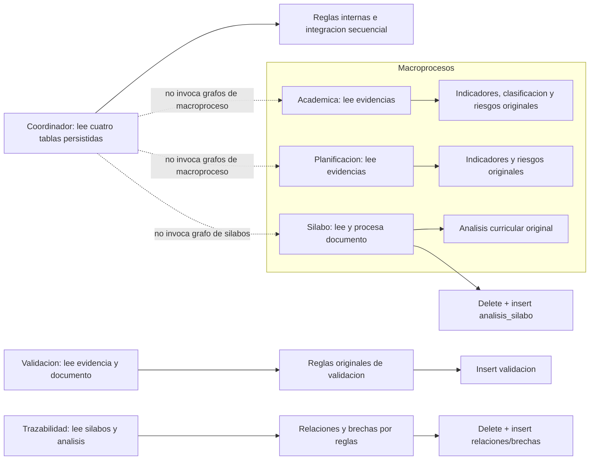

# Verificación aislada de los grafos originales

## Alcance y límites

Se importaron, compilaron con LangGraph instalado en `.venv-evaluation` y ejecutaron los seis grafos originales usando exclusivamente fixtures sintéticos. No se modificó ningún grafo productivo. Las dependencias de acceso se sustituyeron antes de importar esos módulos: cliente Supabase en memoria, lectores de documentos sintéticos, recomendadores Gemini etiquetados como dobles y `HTTPException` de importación. Además, las ejecuciones bloquearon `socket.connect`, `socket.create_connection` y `urllib.request.urlopen`.

Los dobles de Supabase registran cada `select`, `delete` e `insert` en memoria; las escrituras solo devuelven respuestas vacías y nunca alteran ni siquiera el fixture de lectura. El lector únicamente admite URLs `https://synthetic.invalid/`. No se leyeron `.env`, credenciales ni expedientes reales. La instalación del entorno no se modificó.

## Inventario de dependencias

| Grafo original | Constructor y nodos (orden ejecutado) | Datos/funciones de dominio | Servicios/efectos | Gemini y fallback productivo |
|---|---|---|---|---|
| Sílabos (`syllabus_graph.py`) | `construir_grafo_analisis`: obtener, validar archivo, extraer texto, analizar, recomendar, guardar | Usa `curricular_analyzer.analizar_texto_silabo`; descarga texto por `extraer_texto_desde_url` | Lee `silabos` por ID; `guardar_analisis` borra por `silabo_id` e inserta el nuevo análisis en `analisis_silabo` | `gemini_recommender`; recomendador original dispone de fallback por reglas. En la prueba se usó un doble explícito; no se verificó Gemini ni su fallback real. |
| Gestión Académica (`gestion_academica_graph.py`) | `construir_grafo_gestion_academica`: obtener evidencias, indicadores, clasificación, acuerdos, riesgos, recomendación, preparar resultado | Funciones originales extraídas: `calcular_indicadores_gestion_academica`, `clasificar_evidencias_academicas`, `detectar_riesgos_academicos`; nodo original `detectar_acuerdos_pendientes` | Lee `macroproceso_evidencias` filtrando el macroproceso; no persiste desde este grafo | `gemini_gestion_academica_recommender`; tiene fallback por reglas. Se sustituyó por doble. |
| Planificación (`planificacion_graph.py`) | `construir_grafo_planificacion`: obtener evidencias, indicadores, riesgos, recomendación, preparar resultado, devolver análisis | Funciones originales extraídas: `calcular_indicadores_planificacion`, `detectar_riesgos_estrategicos` | Lee `macroproceso_evidencias` filtrando el macroproceso; `guardar_o_devolver_analisis` solo devuelve el estado | `gemini_planificacion_recommender`; tiene fallback por reglas. Se sustituyó por doble. |
| Validación de evidencias (`validacion_evidencia_graph.py`) | `construir_grafo_validacion_evidencia`: obtener, extraer texto, validar reglas, recomendar, guardar | Ejecuta `_evaluar_por_reglas`, normalización, tokens y detección de elementos | Lee `macroproceso_evidencias` por ID; lee documento; inserta en `validacion_ia_macroproceso_evidencias` | `gemini_validacion_evidencia_recommender`; dispone de fallback por reglas. Se sustituyó por doble. |
| Trazabilidad curricular (`trazabilidad_graph.py`) | `construir_grafo_trazabilidad`: obtener sílabos/análisis, agrupar, analizar relaciones, brechas, enriquecer, guardar relaciones, guardar brechas | Ejecuta funciones originales de progresión, familias temáticas, intersección, detección de relaciones y brechas | Lee `silabos` y `analisis_silabo`; borra e inserta en `trazabilidad_curricular` y `brechas_curriculares` | `gemini_trazabilidad_recommender` puede buscar contexto vectorial (que también inicializa/usa Supabase) y tiene fallback por reglas. El módulo recomendador completo fue sustituido: no se hizo llamada vectorial/Gemini. El doble devolvió `activo=False`. |
| Coordinador (`mejora_continua_coordinator.py`) | `construir_grafo_coordinador_mejora_continua`: obtener datos, analizar Planificación, Gestión Académica y Sílabos, integrar hallazgos, calcular riesgo, recomendar, preparar resultado | Ejecuta sus propias funciones de reglas sobre filas persistidas; no invoca los grafos anteriores ni recibe directamente sus estados de ejecución | Lee `macroproceso_evidencias`, `acciones_mejora`, `brechas_curriculares` y `silabos`; no escribe | `gemini_mejora_continua_recommender`; también usa contexto vectorial y tiene fallback por reglas. Se sustituyó por doble. |

### Estado y salidas finales

- Sílabos comparte `SyllabusAnalysisState` (`silabo_id`, `silabo`, `archivo_url`, `texto`, `analisis`, `resultado_guardado`, `error`); devuelve el análisis y la respuesta de guardado.
- Gestión Académica comparte `GestionAcademicaState`; `resultado` conserva nivel de riesgo, resumen, indicadores, riesgos, acuerdos, observaciones, evidencias críticas y acciones/recomendaciones.
- Planificación comparte `PlanificacionState`; `resultado` conserva nivel de riesgo, resumen, riesgos, evidencias críticas, acciones sugeridas y dashboard.
- Validación comparte `ValidacionEvidenciaState`; termina en `resultado` con el resultado base enriquecido y, si el cliente productivo respondiera, `id`/`created_at` de persistencia.
- Trazabilidad comparte `TrazabilidadState`; retorna relaciones, brechas, conclusión, modelo y respuestas de los nodos de guardado.
- El Coordinador comparte `CoordinadorState`; `resultado` contiene diagnósticos por proceso, indicadores generales, hallazgos, riesgo y recomendación.

### Estructura observada

El coordinador es un grafo secuencial de integración sobre snapshots persistidos. Sus funciones `analizar_planificacion`, `analizar_gestion_academica` y `analizar_gestion_silabos` vuelven a derivar métricas propias de esas filas; no consumen la salida devuelta por los otros tres grafos ni los ejecutan como subgrafos. Por tanto, no se describe como orquestador que compone las ejecuciones originales de los tres agentes.

## Grafos compilados y recorridos

Los seis constructores devolvieron grafos compilados por LangGraph real; todos se ejecutaron mediante `stream(..., stream_mode="updates")`, registrando orden de nodos, estado inicial/final y operaciones interceptadas. Los recorridos fueron lineales, según las aristas del código.

| Grafo | Compiló | Se ejecutó | Nodos recorridos | Funciones originales verificadas | Dependencias simuladas | Bloqueos/limitaciones |
|---|---:|---:|---|---|---|---|
| Sílabos | Sí | Sí | 6 | `analizar_texto_silabo` y nodos de validación/extracción/guardado | Supabase, lector sintético, Gemini | `HTTPException` se sustituyó porque FastAPI no está instalado en `.venv-evaluation`; se verificó también el fallo temprano sin archivo. |
| Gestión Académica | Sí | Sí | 7 | Indicadores, clasificación, acuerdos pendientes y riesgos | Supabase, Gemini | Ninguno para recorrido sintético; no se validó modelo real ni servicio. |
| Planificación | Sí | Sí | 6 | Indicadores y detección de riesgos | Supabase, Gemini | Ninguno para recorrido sintético; no se validó modelo real ni servicio. |
| Validación de evidencias | Sí | Sí | 5 | `_evaluar_por_reglas` y nodos originales | Supabase, lector sintético, Gemini | No se validó la descarga real ni el recomendador real. |
| Trazabilidad | Sí | Sí | 7 | Agrupación, análisis de relaciones y detección de brechas | Supabase, Gemini/vector context | No se validó el servicio vectorial ni Gemini real. La muestra hizo que el grafo ejecutara los `delete` originales y un `insert` de brechas, todos interceptados. |
| Coordinador | Sí | Sí | 8 | Reglas propias de los tres macroprocesos, integración y riesgo general | Supabase, Gemini | La coordinación probada es sobre filas simuladas; no prueba sincronización real entre resultados persistidos. |

El detalle reproducible —nodo por nodo, estado, funciones originales, dobles y acciones— está en `evaluation/tests/test_original_graph_execution.py`. Los nombres `TEST_DOUBLE_GEMINI_*` distinguen respuestas sintéticas de cualquier resultado del modelo real. Los análisis de reglas y `analizar_texto_silabo` sí son funciones originales ejecutadas.

## Efectos interceptados y manejo de errores

- Sílabos: se observó el intento de `delete` e `insert` en `analisis_silabo`; el doble no persistió. Un sílabo sintético sin `archivo_url` detuvo el flujo con error HTTP 400 antes de Gemini o escritura.
- Validación: se observó un `insert` en `validacion_ia_macroproceso_evidencias`; no se almacenó.
- Trazabilidad: el grafo emite `delete` en `trazabilidad_curricular` y `brechas_curriculares`, incluso si la colección de relaciones está vacía; para la brecha sintética intentó también un `insert` en `brechas_curriculares`. Las operaciones quedaron registradas y descartadas.
- Académica, Planificación y Coordinador: solo se registraron lecturas `select`; no se detectaron escrituras en su recorrido.
- La red estuvo bloqueada durante cada recorrido. El lector de documentos rechazó cualquier origen ajeno a `synthetic.invalid`.

La ejecución prueba que los nodos originales recorren y componen datos en memoria en estas entradas; no valida servicios remotos, credenciales, formato real de documentos ni comportamiento de Gemini. En particular, fallback real no equivale al doble utilizado en la prueba.

## Evaluación, clasificación normativa y persistencia

Las salidas de los grafos son diccionarios analíticos. Las brechas curriculares describen articulación, repetición, vacíos o estructura del sílabo; no son automáticamente no conformidades ni dictámenes de acreditación. En las pruebas no se suministró Ground Truth ni se generó `CriterionResult`.

La compatibilidad de la respuesta completa de Sílabos, Académica y Planificación con `AnalyticalExecutionRecord.analysis_data` se comprobó en memoria: se guardó la salida de estado completa, con macroproceso sintético asociado y `normative_results=None`. El registro también puede incluir nodos, dependencias dobles y operaciones interceptadas en `provenance`. Esto no se extendió al Coordinador ni a los grafos de soporte: el primero agrupa varios procesos y los segundos no equivalen a una ejecución de macroproceso. Las trazas de esta fase son efímeras, no se conectan a `BenchmarkRunner` y no son ejecuciones de tesis.

Para conservar permanentemente las trazas, el siguiente paso sería acordar un contrato/versionado específico que diferencie ejecución original, doble de servicio, nodos, efectos interceptados y resultados analíticos, separado de los dictámenes normativos.

## Pruebas y cambios

Prueba nueva: `evaluation/tests/test_original_graph_execution.py` (8 casos), con doble de cliente que intercepta lecturas y escrituras, doble de lector, dobles Gemini identificados, bloqueo de red y compilación/ejecución real de los seis grafos. Se mantiene intacta la suite previa.

No se modificaron los seis módulos productivos, endpoints, frontend, esquemas, migraciones, persistencia ni instrumentos OE1–OE5. No se instalaron dependencias, no se hicieron llamadas externas y no se guardaron escrituras de prueba. La única limitación de importación resuelta con stub fue FastAPI, ausente del entorno de evaluación; LangGraph sí se usó realmente.

## Pendientes mínimos

1. Repetir validación de integración en un entorno que contenga las dependencias de backend, pero manteniendo credenciales de prueba y servicios interceptados.
2. Si se necesita almacenar estas verificaciones, definir primero un contrato de traza independiente con firma/hash del código, nodos, dependencias simuladas, operaciones interceptadas y estado técnico.
3. Para la evaluación normativa, acordar criterios oficiales, aplicabilidad y Ground Truth revisado; no inferirlos de riesgos ni brechas actuales.
